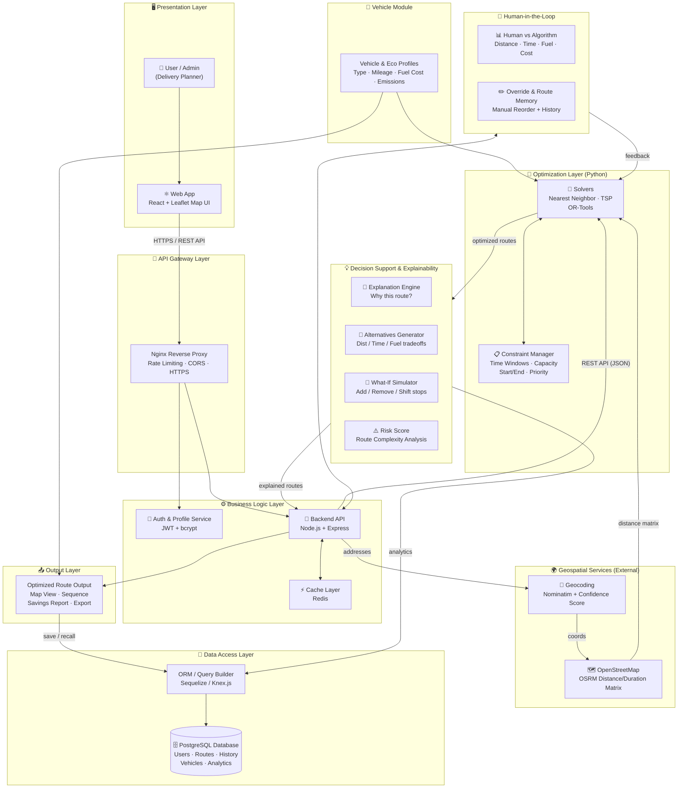
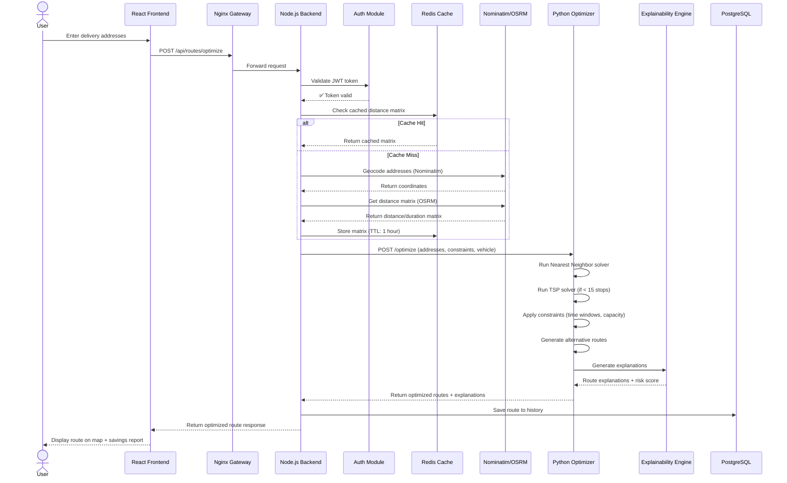
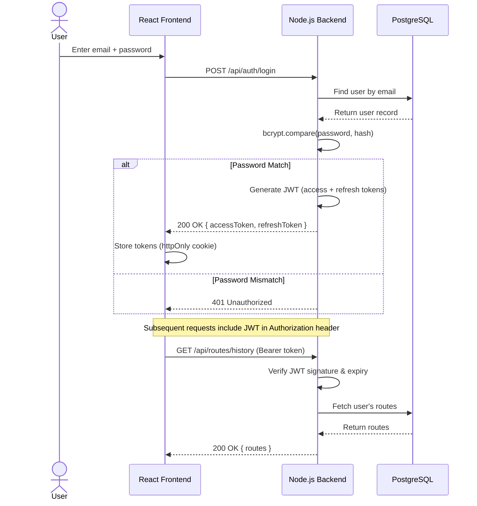
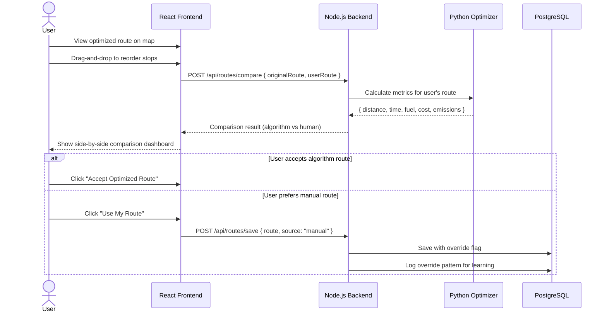
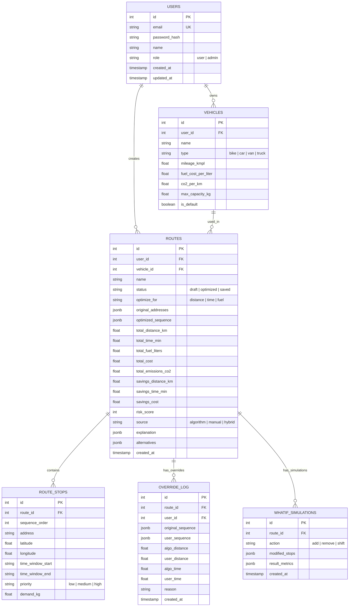
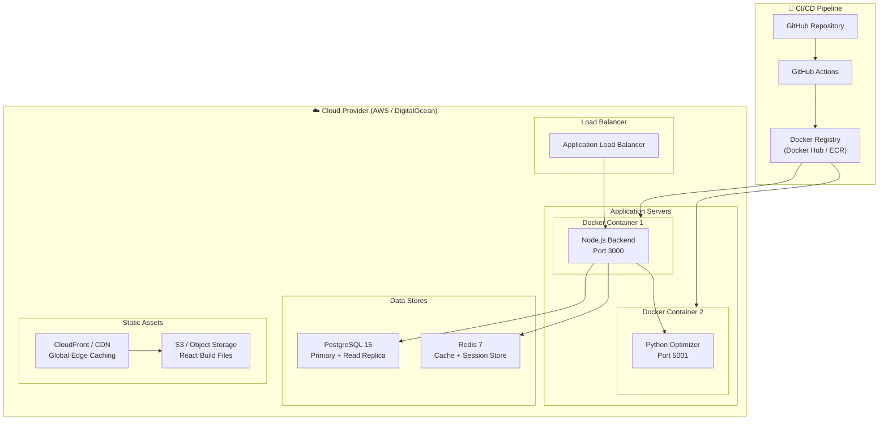

# RouteNinja — Software Architecture Design Document

## Smart and Explainable Route Optimization System

**Version:** 2.0  
**Date:** September 2026  
**Author:** Akshar  

---

## Table of Contents

1. [System Overview](#1-system-overview)
2. [Architecture Style & Justification](#2-architecture-style--justification)
3. [High-Level Architecture Diagram](#3-high-level-architecture-diagram)
4. [Layered Component Breakdown](#4-layered-component-breakdown)
5. [Data Flow Diagrams](#5-data-flow-diagrams)
6. [Database Design (ER Diagram)](#6-database-design)
7. [API Design](#7-api-design)
8. [Security Architecture](#8-security-architecture)
9. [Deployment Architecture](#9-deployment-architecture)
10. [Non-Functional Requirements](#10-non-functional-requirements)
11. [Technology Stack Justification](#11-technology-stack-justification)
12. [Risk & Mitigation](#12-risk--mitigation)

---

## 1. System Overview

### 1.1 Purpose

RouteNinja is a smart, explainable route optimization system designed for delivery planners. It calculates the most efficient delivery routes by minimizing distance, time, and fuel consumption while respecting real-world constraints (time windows, vehicle capacity, priorities). The system stands out by providing **explainable AI** — users can understand *why* a particular route was chosen, compare alternatives, and override decisions when needed.

### 1.2 Goals

- Optimize multi-stop delivery routes using TSP and Nearest Neighbor heuristics
- Reduce delivery costs (distance, time, fuel, emissions)
- Provide transparent, explainable route decisions
- Allow human override with comparison analytics
- Support what-if simulations for planning flexibility
- Track and learn from historical route data

### 1.3 Stakeholders

| Stakeholder | Role | Concerns |
|---|---|---|
| Delivery Planner (User) | Primary user, creates & manages routes | Ease of use, accuracy, speed |
| Fleet Manager (Admin) | Manages vehicles, drivers, profiles | Cost savings, compliance |
| System Administrator | Maintains infrastructure | Uptime, security, scalability |
| Business Owner | Decision maker | ROI, cost reduction metrics |

### 1.4 Key Use Cases

1. **UC-01:** User inputs delivery addresses and gets an optimized route
2. **UC-02:** User views explanation of why a route was chosen
3. **UC-03:** User manually overrides/reorders stops and compares with algorithm
4. **UC-04:** User runs what-if simulation (add/remove/shift stops)
5. **UC-05:** User saves routes and recalls them later
6. **UC-06:** Admin manages vehicle & eco profiles

---

## 2. Architecture Style & Justification

### 2.1 Chosen Style: **Modular Monolith with Service Separation**

RouteNinja uses a **modular monolith** architecture for the backend (Node.js + Express) with a **separate microservice** for the Route Optimization Engine (Python).

### 2.2 Why Not Full Microservices?

| Factor | Microservices | Modular Monolith (Chosen) |
|---|---|---|
| Complexity | High (service mesh, orchestration) | Low-Medium |
| Deployment | Complex (multiple containers) | Simpler (2 services) |
| Team Size | Needs large teams | Suitable for small teams |
| Performance | Network overhead between services | In-process calls + 1 API boundary |
| Scalability | Independent scaling | Scale the bottleneck (Python engine) |

### 2.3 Why Separate the Python Engine?

- Route optimization is **CPU-intensive** — isolating it prevents blocking the main API
- Python has superior scientific computing libraries (OR-Tools, NetworkX, NumPy)
- Can be **scaled independently** (horizontal scaling with load balancer)
- Can be **replaced or upgraded** without touching the main backend

---

## 3. High-Level Architecture Diagram



---

## 4. Layered Component Breakdown

### 4.1 Presentation Layer

| Component | Technology | Responsibility |
|---|---|---|
| Web Application | React 18 + Vite | Single Page Application (SPA) |
| Map UI | Leaflet.js + OpenStreetMap tiles | Interactive route visualization |
| State Management | React Context / Zustand | Client-side state |
| HTTP Client | Axios | API communication with interceptors |
| UI Framework | Tailwind CSS / Ant Design | Responsive, accessible design |

**Key Features:**
- Interactive map with draggable waypoints
- Real-time route preview on the map
- Side-by-side comparison panel (human vs algorithm)
- Dashboard with savings metrics and history

### 4.2 API Gateway Layer

| Component | Technology | Responsibility |
|---|---|---|
| Reverse Proxy | Nginx | SSL termination, load balancing |
| Rate Limiter | express-rate-limit | Prevent API abuse (100 req/min) |
| CORS Policy | cors middleware | Restrict origins |
| Request Logger | Morgan + Winston | HTTP request logging |

### 4.3 Business Logic Layer (Node.js Backend)

| Module | Endpoints | Responsibility |
|---|---|---|
| Auth Module | `POST /api/auth/register, /login, /refresh` | Registration, login, JWT tokens |
| User Module | `GET/PUT /api/users/profile` | Profile management |
| Route Module | `POST /api/routes/optimize` | Route optimization orchestration |
| History Module | `GET /api/routes/history` | Saved routes & analytics |
| Vehicle Module | `CRUD /api/vehicles` | Vehicle profile management |
| Admin Module | `GET /api/admin/analytics` | System-wide analytics |

### 4.4 Route Optimization Engine (Python)

| Component | Library | Responsibility |
|---|---|---|
| Solver: Nearest Neighbor | Custom implementation | Fast greedy heuristic |
| Solver: TSP (Branch & Bound) | OR-Tools / python-tsp | Exact/optimal solution for small inputs |
| Solver: Genetic Algorithm | DEAP (optional) | Meta-heuristic for large inputs |
| Constraint Manager | Custom | Enforce time windows, capacity, priority |
| Distance Matrix Builder | OSRM API client | Real road distance/duration matrix |

**Communication Protocol:**
```
Node.js Backend  ──── REST API (JSON) ────►  Python Flask/FastAPI Server
                                              Port 5001
                                              Endpoint: POST /optimize
```

**Request Payload Example:**
```json
{
  "addresses": [
    { "id": 1, "lat": 12.9716, "lng": 77.5946, "timeWindow": ["09:00", "12:00"], "priority": "high" },
    { "id": 2, "lat": 12.2958, "lng": 76.6394, "timeWindow": ["10:00", "14:00"], "priority": "medium" }
  ],
  "vehicleProfile": { "type": "van", "mileage": 12, "fuelCost": 100, "capacity": 500 },
  "startLocation": { "lat": 12.9716, "lng": 77.5946 },
  "returnToStart": true,
  "optimizeFor": "distance"
}
```

### 4.5 Geospatial Services (External APIs)

| Service | Provider | Purpose | Fallback |
|---|---|---|---|
| Geocoding | Nominatim (OSM) | Address → Coordinates | Google Maps Geocoding API |
| Distance Matrix | OSRM (self-hosted or public) | Real road distances & durations | Haversine formula (straight-line) |
| Map Tiles | OpenStreetMap | Map rendering in frontend | Mapbox tiles |

### 4.6 Decision Support & Explainability Layer

This is what makes RouteNinja unique:

| Feature | How It Works |
|---|---|
| **Route Explanation** | For each route, generate a natural language explanation: *"Stop B comes before Stop C because it has a tighter time window (09:00–11:00) and is 3.2 km closer from Stop A"* |
| **Alternatives** | Generate 2–3 alternative routes optimized for different objectives (shortest distance vs fastest time vs lowest fuel) |
| **What-If Simulation** | User can add/remove/shift a stop and instantly see the impact on total distance, time, and cost |
| **Risk Score** | Compute a complexity score (0–100) based on: number of stops, tight time windows, long distances, capacity utilization |

### 4.7 Human-in-the-Loop Module

| Feature | Description |
|---|---|
| **Comparison Dashboard** | Side-by-side KPI comparison: Algorithm route vs Human-reordered route (distance, time, fuel, cost, emissions) |
| **Manual Override** | Drag-and-drop reordering of stops on the map |
| **Route Memory** | Save human preferences; over time, learn patterns (e.g., "user always visits Stop X first") |
| **Feedback Loop** | Human overrides are logged and can be used to improve future suggestions |

---

## 5. Data Flow Diagrams

### 5.1 Route Optimization — End-to-End Flow



### 5.2 Authentication Flow



### 5.3 Human-in-the-Loop Override Flow



---

## 6. Database Design

### 6.1 Entity-Relationship Diagram



### 6.2 Key Indexes

```sql
CREATE INDEX idx_routes_user_id ON routes(user_id);
CREATE INDEX idx_routes_created_at ON routes(created_at DESC);
CREATE INDEX idx_route_stops_route_id ON route_stops(route_id);
CREATE INDEX idx_override_log_user_id ON override_log(user_id);
```

---

## 7. API Design

### 7.1 API Style: RESTful JSON API (v1)

**Base URL:** `https://api.routeninja.com/v1`

### 7.2 Key Endpoints

| Method | Endpoint | Description | Auth |
|---|---|---|---|
| `POST` | `/auth/register` | Register new user | No |
| `POST` | `/auth/login` | Login, get JWT tokens | No |
| `POST` | `/auth/refresh` | Refresh access token | Yes |
| `GET` | `/users/profile` | Get current user profile | Yes |
| `PUT` | `/users/profile` | Update profile | Yes |
| `POST` | `/routes/optimize` | Submit addresses for optimization | Yes |
| `GET` | `/routes/:id` | Get a specific saved route | Yes |
| `GET` | `/routes/history` | List user's saved routes (paginated) | Yes |
| `DELETE` | `/routes/:id` | Delete a saved route | Yes |
| `POST` | `/routes/:id/compare` | Compare algorithm vs manual route | Yes |
| `POST` | `/routes/:id/whatif` | Run what-if simulation | Yes |
| `POST` | `/routes/:id/explain` | Get detailed explanation | Yes |
| `GET` | `/vehicles` | List user's vehicles | Yes |
| `POST` | `/vehicles` | Add a vehicle profile | Yes |
| `PUT` | `/vehicles/:id` | Update vehicle profile | Yes |
| `DELETE` | `/vehicles/:id` | Delete vehicle profile | Yes |
| `GET` | `/admin/analytics` | System-wide analytics | Admin |

### 7.3 Error Response Format

```json
{
  "success": false,
  "error": {
    "code": "VALIDATION_ERROR",
    "message": "At least 2 addresses are required for route optimization",
    "details": [
      { "field": "addresses", "message": "Array must contain at least 2 items" }
    ]
  }
}
```

### 7.4 Rate Limiting

| Tier | Limit | Window |
|---|---|---|
| Unauthenticated | 20 requests | per minute |
| Authenticated (Free) | 100 requests | per minute |
| Authenticated (Pro) | 500 requests | per minute |
| Optimization endpoint | 10 requests | per minute |

---

## 8. Security Architecture

### 8.1 Security Layers

```mermaid
graph LR
    subgraph External
        A["HTTPS (TLS 1.3)"]
    end
    subgraph Gateway
        B["Nginx<br/>SSL Termination"]
        C["Rate Limiting"]
        D["CORS Policy"]
        E["Helmet.js<br/>Security Headers"]
    end
    subgraph Application
        F["JWT Authentication<br/>Access + Refresh Tokens"]
        G["bcrypt Password Hashing<br/>Salt Rounds: 12"]
        H["Input Validation<br/>Joi / Zod Schema"]
        I["SQL Injection Prevention<br/>Parameterized Queries"]
    end
    subgraph Data
        J["Encryption at Rest<br/>PostgreSQL TDE"]
        K["Backup Encryption<br/>AES-256"]
    end
    A --> B --> C --> D --> E --> F --> G --> H --> I --> J --> K
```



### 8.2 Authentication Strategy

| Aspect | Implementation |
|---|---|
| Password Storage | bcrypt with 12 salt rounds |
| Access Token | JWT, 15-minute expiry, stored in httpOnly cookie |
| Refresh Token | JWT, 7-day expiry, stored in httpOnly cookie + DB |
| Token Rotation | New refresh token on each refresh request |
| Logout | Blacklist refresh token in Redis |

### 8.3 Additional Security Measures

- **OWASP Top 10** compliance
- **Input sanitization** using `express-validator`
- **XSS protection** via Helmet.js + Content-Security-Policy
- **CSRF protection** via SameSite cookies + CSRF tokens
- **Dependency scanning** using `npm audit` + Snyk

---

## 9. Deployment Architecture

### 9.1 Deployment Diagram



### 9.2 CI/CD Pipeline Stages

```
1. Push to GitHub → 
2. GitHub Actions Triggered →
3. Run Linting (ESLint + Pylint) →
4. Run Unit Tests (Jest + Pytest) →
5. Run Integration Tests →
6. Build Docker Images →
7. Push to Docker Registry →
8. Deploy to Staging →
9. Run Smoke Tests →
10. Deploy to Production (manual approval)
```

### 9.3 Environment Separation

| Environment | Purpose | Database | URL |
|---|---|---|---|
| Development | Local dev | SQLite / Local PG | `localhost:3000` |
| Staging | Pre-release testing | Staging PostgreSQL | `staging.routeninja.com` |
| Production | Live users | Production PostgreSQL | `app.routeninja.com` |

---

## 10. Non-Functional Requirements

| Requirement | Target | Strategy |
|---|---|---|
| **Response Time** | < 2s for route optimization (≤10 stops) | Redis caching, OSRM pre-computation |
| **Throughput** | 100 concurrent users | Horizontal scaling, load balancer |
| **Availability** | 99.5% uptime | Health checks, auto-restart, DB replicas |
| **Scalability** | Support up to 50 stops per route | Algorithm complexity management, async processing |
| **Data Retention** | 1 year route history | Archival to cold storage after 6 months |
| **Recovery (RPO/RTO)** | RPO: 1 hour, RTO: 4 hours | Automated daily backups, point-in-time recovery |
| **Accessibility** | WCAG 2.1 AA | Semantic HTML, keyboard navigation, screen reader support |
| **Browser Support** | Chrome, Firefox, Safari, Edge (latest 2 versions) | Progressive enhancement, polyfills |

---

## 11. Technology Stack Justification

| Layer | Technology | Why This Choice? |
|---|---|---|
| **Frontend** | React 18 + Vite | Component-based UI, fast HMR, large ecosystem |
| **Map Library** | Leaflet.js | Open-source, lightweight, great OSM integration |
| **Backend** | Node.js + Express | Non-blocking I/O, fast JSON handling, npm ecosystem |
| **Optimization** | Python + OR-Tools | Best-in-class optimization libraries, scientific computing |
| **API Framework (Python)** | FastAPI | Async support, auto-generated docs, type validation |
| **Database** | PostgreSQL | JSONB support, spatial queries (PostGIS), reliability |
| **Cache** | Redis | Sub-millisecond reads, TTL support, pub/sub |
| **Reverse Proxy** | Nginx | Battle-tested, SSL termination, rate limiting |
| **Containerization** | Docker + Docker Compose | Consistent environments, easy deployment |
| **CI/CD** | GitHub Actions | Free for open source, integrated with GitHub |
| **Geocoding** | Nominatim (OSM) | Free, no API key limits, privacy-friendly |
| **Routing** | OSRM | Fast, real road distances, self-hostable |

---

## 12. Risk & Mitigation

| Risk | Impact | Probability | Mitigation |
|---|---|---|---|
| Nominatim API downtime | Cannot geocode addresses | Medium | Fallback to Google Maps Geocoding API |
| OSRM service failure | Cannot compute distances | Medium | Fallback to Haversine formula (straight-line) |
| Python engine timeout | Route optimization hangs | Low | 30s timeout, return best-known solution |
| Database corruption | Data loss | Low | Daily backups, point-in-time recovery |
| JWT token theft | Unauthorized access | Low | Short expiry (15 min), token rotation, httpOnly cookies |
| DDoS attack | Service unavailable | Low | Rate limiting, Cloudflare WAF, auto-scaling |
| Algorithm gives poor results | User dissatisfaction | Medium | Multiple solvers, human override, feedback loop |

---

## Appendix A: Folder Structure

```
routeninja/
├── client/                     # React Frontend
│   ├── src/
│   │   ├── components/         # Reusable UI components
│   │   ├── pages/              # Route pages (Dashboard, Optimize, History)
│   │   ├── hooks/              # Custom React hooks
│   │   ├── services/           # API client (Axios)
│   │   ├── store/              # State management
│   │   └── utils/              # Helper functions
│   ├── public/
│   └── package.json
│
├── server/                     # Node.js Backend
│   ├── src/
│   │   ├── controllers/        # Route handlers
│   │   ├── middleware/          # Auth, validation, error handling
│   │   ├── models/             # Sequelize/Knex models
│   │   ├── routes/             # Express route definitions
│   │   ├── services/           # Business logic
│   │   └── utils/              # Helpers, logger, config
│   ├── tests/
│   └── package.json
│
├── optimizer/                  # Python Optimization Engine
│   ├── app/
│   │   ├── solvers/            # Nearest Neighbor, TSP, Genetic
│   │   ├── constraints/        # Time windows, capacity
│   │   ├── explainability/     # Route explanation generator
│   │   └── api/                # FastAPI endpoints
│   ├── tests/
│   └── requirements.txt
│
├── docker-compose.yml
├── nginx.conf
└── README.md
```

---

*End of Architecture Document*
